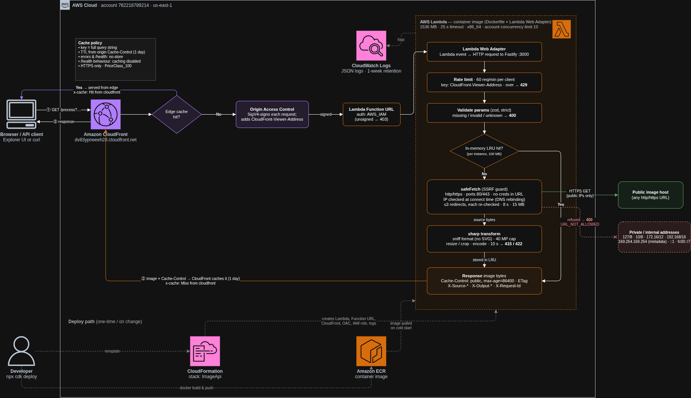

# image_api

A small Cloudinary-style image processing service: give it an image URL and it
resizes, crops and re-encodes it on the fly. Includes an explorer UI at `/`.

> **Live:** https://dv83ypneeeh28.cloudfront.net (explorer UI) ·
> [health](https://dv83ypneeeh28.cloudfront.net/health) ·
> [example](https://dv83ypneeeh28.cloudfront.net/process?url=https://upload.wikimedia.org/wikipedia/commons/4/47/PNG_transparency_demonstration_1.png&width=400&format=webp)
>
> Hosted on AWS Lambda: the first request after an idle period is a cold start and can take several seconds.

## Quick start

```bash
nvm use            # Node 24 (see .nvmrc)
npm install
npm run dev        # http://localhost:3000
npm test
```

Docker:

```bash
docker build -t image-api .
docker run --rm -p 3000:3000 image-api
```

Configuration is environment-only; see [.env.example](.env.example) for every knob and its default.

## API

### `GET /process`

| Param     | Type                              | Notes                                                    |
|-----------|-----------------------------------|----------------------------------------------------------|
| `url`     | http(s) URL, **required**         | Public image to transform                                |
| `width`   | int 1–4000                        | Omit one of width/height to keep aspect ratio            |
| `height`  | int 1–4000                        |                                                          |
| `format`  | `jpeg` (`jpg`), `png`, `webp`, `avif` | Defaults to the source format (gif/tiff → png)       |
| `quality` | int 1–100                         | Lossy formats only                                       |
| `crop`    | `fit` (default), `fill`, `scale`, `pad` | Needs width and/or height                          |

```bash
curl -o out.webp "http://localhost:3000/process?url=https://upload.wikimedia.org/wikipedia/commons/4/47/PNG_transparency_demonstration_1.png&width=400&format=webp"
```

Crop modes: **fit** scales to fit inside the box · **fill** covers the box and crops the overflow ·
**scale** stretches to the exact box · **pad** fits inside and pads the remainder.

Response headers worth knowing: `X-Source-{Format,Width,Height,Bytes}`, `X-Output-{Width,Height}`,
`X-Cache: HIT|MISS`, `ETag`, `Cache-Control`, `X-Request-Id`, `X-RateLimit-*`.

### Errors

Every error has the same shape:

```json
{ "error": { "code": "INVALID_PARAMS", "message": "width must be at most 4000", "details": [{ "param": "width", "message": "..." }] },
  "requestId": "..." }
```

| Status | Code                     | When                                                         |
|--------|--------------------------|--------------------------------------------------------------|
| 400    | `INVALID_PARAMS`         | Missing/invalid/unknown parameters                           |
| 400    | `URL_NOT_ALLOWED`        | Non-http(s) scheme, private/internal address, odd port, creds in URL |
| 415    | `UNSUPPORTED_MEDIA_TYPE` | Source isn't a supported image                               |
| 422    | `SOURCE_TOO_LARGE`       | Over the byte or pixel limit                                 |
| 429    | `RATE_LIMITED`           | Too many requests                                            |
| 502    | `SOURCE_ERROR` / `SOURCE_UNREACHABLE` | Upstream returned non-2xx / couldn't connect    |
| 504    | `SOURCE_TIMEOUT`         | Upstream too slow                                            |

### `GET /health`

Liveness plus cache hit/miss counters.

## Architecture



<sub>Request flow as deployed on AWS. The PNG embeds its diagrams.net source: open
[`docs/request-flow.drawio.png`](docs/request-flow.drawio.png) in [diagrams.net](https://app.diagrams.net) to edit it.</sub>

TypeScript on Node 24: [Fastify](https://fastify.dev) for HTTP, [sharp](https://sharp.pixelplumbing.com) (libvips) for
image work, [zod](https://zod.dev) for validation, Vitest for tests. The UI is plain HTML/JS in `public/`, served by
the same app, and calls `/process` exactly like any other client.

A `/process` request flows through four small modules:

```
GET /process
  │
  ├─ params.ts      parse + validate the query (zod) → typed ProcessParams, or 400 with per-param details
  ├─ cache.ts       LRU keyed on the normalised params; single-flight so concurrent identical requests share one job
  │    └─ on miss:
  │       ├─ fetch/safeFetch.ts   SSRF-guarded download (see Limits & safeguards)
  │       └─ transform.ts         sniff format → resize/crop → encode (sharp)
  └─ routes/process.ts            headers (Cache-Control, ETag/304, X-Source-*, X-Output-*), rate limiting
```

| File | Responsibility |
|---|---|
| `src/app.ts` | Builds the Fastify app: error envelope, request IDs, CORS, routes, static UI. Dependencies are injectable so tests swap the network fetcher for fixtures. |
| `src/config.ts` | All configuration from environment variables, validated at startup. |
| `src/errors.ts` | `ApiError` with stable codes mapped to HTTP statuses. |
| `src/fetch/ipPolicy.ts` | "Is this address publicly routable?" for IPv4/IPv6, including v4-mapped v6. |
| `src/fetch/safeFetch.ts` | URL checks, connect-time DNS guard, manual redirect handling, timeouts, size caps. |
| `src/transform.ts` | Format allowlist, decode limits, crop-mode mapping, encoding. |
| `infra/` | AWS CDK stack (see Deployment). |

## Limits & safeguards

All values are configurable via environment variables ([.env.example](.env.example)).

**Untrusted URLs (SSRF).** This service fetches whatever URL a stranger hands it, so the fetcher is the main attack surface.

| Safeguard | Why |
|---|---|
| Only `http`/`https` | Blocks `file:`, `gopher:`, `ftp:` and similar tricks for reading local files or talking to other protocols. |
| Only ports 80/443 | Stops the service being used to probe arbitrary ports on public hosts. |
| No `user:pass@` in URLs | Avoids forwarding credentials and the parser confusion around them. |
| Private/reserved addresses refused: loopback, RFC 1918, link-local (incl. `169.254.169.254` cloud metadata), CGNAT, IPv6 ULA/link-local, multicast, and v4-mapped forms of all of these | The classic SSRF targets. |
| The address check runs **at connect time** inside the DNS lookup, on the IP actually dialled | Checking a hostname once and connecting later is vulnerable to DNS rebinding; checking the IP being connected to is not. IP literals (which skip DNS) are checked up front. |
| Redirects followed manually (max 3), with every hop re-validated | A public URL redirecting to `http://127.0.0.1/` is the most common SSRF bypass. |

**Resource limits.**

| Limit | Default | Why |
|---|---|---|
| Total fetch time (all hops + body) | 8 s | One budget for the whole download, so a slow-drip server can't hold a worker indefinitely. |
| Source size | 15 MB | Enforced on `Content-Length` *and* while streaming, since the header can lie or be missing. Covers large phone photos. |
| Decoded pixels | 40 MP | Guards against decompression bombs (a tiny file that decodes to gigabytes). 40 MP covers high-end camera output. |
| Output width/height | 4000 px each | Bounds encode time and response size. |
| Processing time | 10 s (sharp timeout) | Backstop for pathological inputs. |
| Input formats | JPEG, PNG, WebP, GIF, AVIF/HEIF, TIFF | Detected from the file's bytes, not the `Content-Type` header. **SVG is excluded**: it's a document format that can carry scripts and external references. |

**Abuse.** `/process` is rate limited to 60 requests/minute per client IP (`429 RATE_LIMITED`, `X-RateLimit-*` headers).
Behind CloudFront the client IP comes from `CloudFront-Viewer-Address` (see Deployment). On AWS, Lambda's concurrency
limit is the hard ceiling on spend.

**Caching.** Successful responses carry `Cache-Control: public, max-age=86400` and a content `ETag` (`If-None-Match` → `304`).
In-process there's a 100 MB LRU of processed results with single-flight de-duplication; in production CloudFront is the
shared cache in front of it. Errors and `/health` are `no-store`, so a CDN never caches a failure.

**Errors.** One envelope everywhere (`{ error: { code, message, details? }, requestId }`), correct status codes, and
messages that say what to fix. Unknown query parameters are rejected rather than ignored, so a typo like `widht=300`
fails loudly instead of silently returning the wrong image. Upstream failure causes are logged server-side with the
request ID but not leaked to clients.

## Trade-offs

- **In-memory cache and rate limiter.** Simple and dependency-free, but per instance. On Lambda each warm instance has its
  own, so the limit is approximate and the LRU mostly helps bursts. CloudFront provides the real shared cache; a shared
  store (Redis/DynamoDB) or AWS WAF rate rules would make limiting exact, at a cost the brief asked to avoid.
- **Synchronous processing.** The request waits for fetch + transform. Fine at this scale; a heavier service would
  store results (S3) and let the CDN serve them.
- **Lambda over a long-running server.** Effectively free and nothing to babysit for the review window, at the price of
  cold starts (several seconds) and Lambda's ~6 MB buffered response limit (a 4000×4000 PNG can exceed it; switching the adapter
  to response streaming raises that to 20 MB).
- **`fit` as the default crop mode.** Never distorts or crops unless asked. Cloudinary's default when both dimensions are
  given is closer to `scale`; I chose the least surprising result.
- **Upstream errors map to 502** (with `details.upstreamStatus`) rather than mirroring the upstream code: a 404 from the
  source host isn't a missing route on *this* API.
- **Vanilla JS UI.** No build step and nothing to deploy separately; a framework would pay off only if the UI grew.

## Observability

Everything stays inside AWS (CloudWatch), is defined in the CDK stack, and fits in the free tier.

**Structured logs.** The app writes one JSON line per request (`msg: "request completed"`) instead of Fastify's
default pair: method, path, full URL and parsed query, status, `errorCode`, `durationMs`, `fetchMs` / `transformMs`,
in-memory `cache` result (`hit` / `miss` / `coalesced`), source host/format/bytes, output format/bytes, request ID,
and the viewer's country. **No client IP is logged**: it's only used, in memory, as the rate-limit key.
The line is written just *before* the response is sent (Fastify `onSend`, synchronous write). Lambda freezes the
environment as soon as a response is delivered, so a line logged afterwards (`onResponse`) showed up in CloudWatch only
when the next request thawed the instance: 166 s late in testing, and never if the instance is reclaimed.

**Metrics without an SDK.** The same line carries CloudWatch
[Embedded Metric Format](https://docs.aws.amazon.com/AmazonCloudWatch/latest/monitoring/CloudWatch_Embedded_Metric_Format_Specification.html)
fields, so CloudWatch extracts metrics from the log itself (no API calls in the request path; locally it's just a log
line). Namespace `ImageApi`, dimension `Service=image-api`, 8 metrics (inside the 10 free custom metrics):
`Latency`, `FetchLatency`, `TransformLatency`, `CacheHit` (average = hit rate), `ClientError`, `ServerError`,
`SourceBytes`, `OutputBytes`. Breakdowns by error code live in Logs Insights rather than as metric dimensions, which
would multiply the metric count.

**Edge logs.** CloudFront serves cache hits without invoking Lambda, so app logs alone undercount. CloudFront access
logs are delivered to CloudWatch (`/aws/vendedlogs/cloudfront/ImageApi-access`) with an explicit field list that
excludes `c-ip`, `c-port`, `x-forwarded-for`, `asn` and cookies. The explorer UI fetches with `cache: 'no-cache'`, so a
repeat run revalidates with CloudFront (usually a `304` from the edge) rather than being answered silently by the
browser cache: timings stay honest and every run is logged.

**Where to look** (console, `us-east-1`):

| What | Where |
|---|---|
| Dashboard: edge traffic and error rates, Lambda invocations/throttles/concurrency, API latency (p50/p95, fetch vs transform), cache hit rate, errors and bytes, recent edge requests, errors by code | CloudWatch → Dashboards → `ImageApi` (URL is a stack output) |
| Every request, including edge cache hits | Logs Insights → Saved queries → `image-api/Every request (edge, incl. cache hits)` |
| What happened inside the API | `image-api/API requests (app detail)` |
| Everything that was rejected, and why | `image-api/Rejected requests` |
| Alarm | `ImageApi-lambda-throttles`: any Lambda throttling in 5 minutes (no notification target configured) |

Logs are kept for 30 days.

## Deployment

AWS, defined in [infra/](infra/) with CDK (TypeScript):

```
Browser ─▶ CloudFront (HTTPS, shared cache keyed on query string)
             └─ OAC-signed ─▶ Lambda Function URL (IAM auth: CloudFront only)
                               └─ Lambda: this repo's Dockerfile + AWS Lambda Web Adapter
```

Full request flow: see the diagram under [Architecture](#architecture).

- The same container image runs locally (`docker run`) and on Lambda; the Web Adapter
  extension is inert outside Lambda.
- CloudFront caches successful `/process` responses per `Cache-Control` (1 day); errors and
  `/health` send `no-store`.
- Concurrency is the hard cost/abuse ceiling: new AWS accounts cap Lambda at 10 concurrent
  executions account-wide (and refuse per-function reservations); on larger accounts pass
  `-c reservedConcurrency=10` to `cdk deploy`. The in-app rate limiter keys on
  `CloudFront-Viewer-Address`, which is trustworthy because the function URL only accepts
  CloudFront-signed requests.
- Cold starts: the first request after an idle period starts a new Lambda container, which took ~10 s
  right after deploy. Warm requests take ~0.3–0.7 s for a fresh transform and ~30–100 ms for a CloudFront cache hit.
- CloudFront replaces the app's `X-Cache` header with its own (`Hit from cloudfront` / `Miss from cloudfront`),
  so in production that header reports the edge cache.

Testing against the deployment:

```bash
B=https://dv83ypneeeh28.cloudfront.net
curl -s $B/health
curl -s -o out.webp -D - "$B/process?url=https://upload.wikimedia.org/wikipedia/commons/4/47/PNG_transparency_demonstration_1.png&width=400&format=webp"
curl -s "$B/process?url=http://169.254.169.254/latest/meta-data/"   # → 400 URL_NOT_ALLOWED
```

Prerequisites: Docker, AWS credentials in the CLI (`aws configure` or `aws login`).

```bash
cd infra
npm install
npx cdk bootstrap   # once per account/region
npx cdk deploy      # builds the image, pushes to ECR, prints the CloudFront URL
npx cdk destroy     # tear down
```

## What I'd do next

- **OpenAPI spec + interactive docs** For past api's I'll often include a swagger endpoint that you keep upto date with the funcitonallity of the different routes.
  (`buildUrl(params)`, typed errors).
- **More transformations:** `format=auto` from the `Accept` header (with `Vary: Accept`), rotate, blur, grayscale, focal-point crops. I did not spend much time understanding the 
- **Shared rate limiting / caching** (WAF rate-based rule or Redis) and persisting outputs to S3.
- **Alerting:** route alarms to SNS/email, and add error-rate and latency SLO alarms; X-Ray tracing for slow upstreams.
- **Video thumbnails** This could be done using ffmpeg, but i didnt want to set this up.
- **Signed URLs** Implement auth with a key store, or cognito or something.
- **CI deploys** This project was deployed via the cdk toolset, from my pc; it would need a pipeline setup for production.
